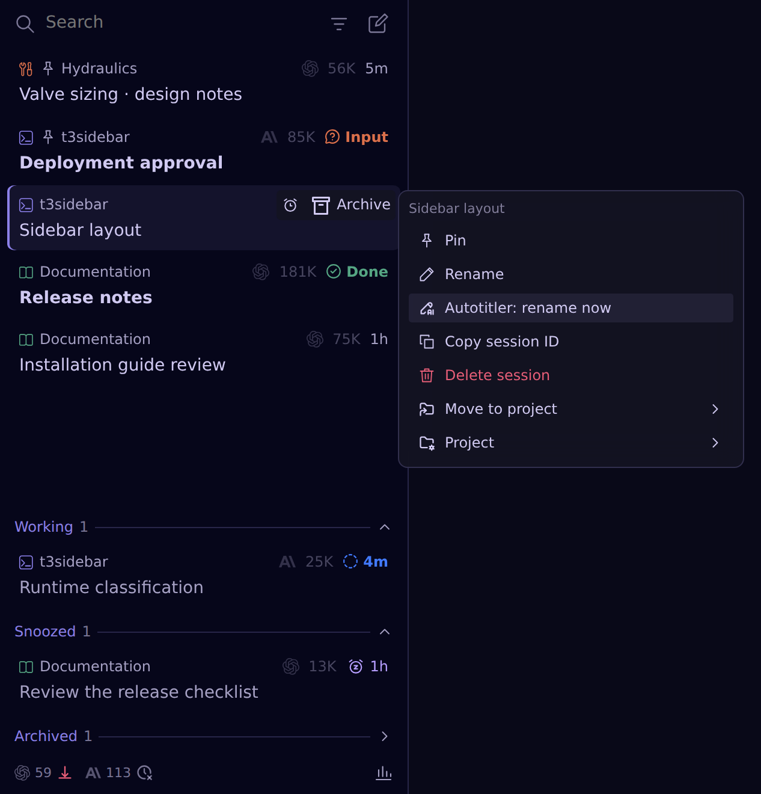
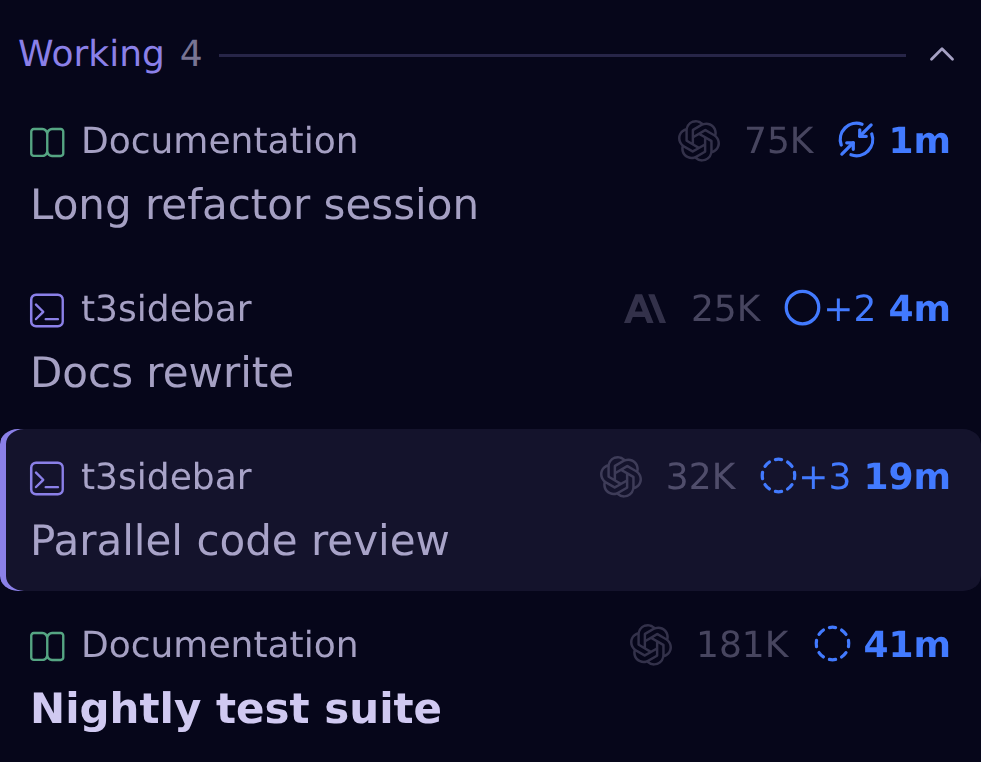
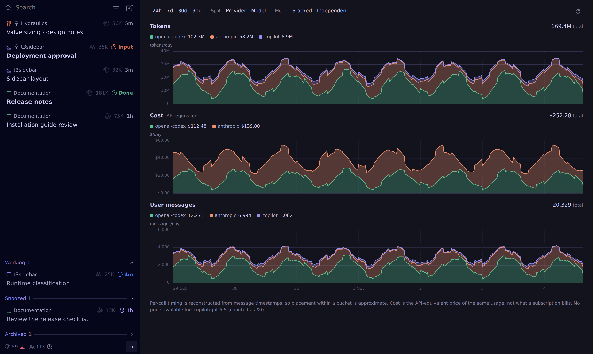
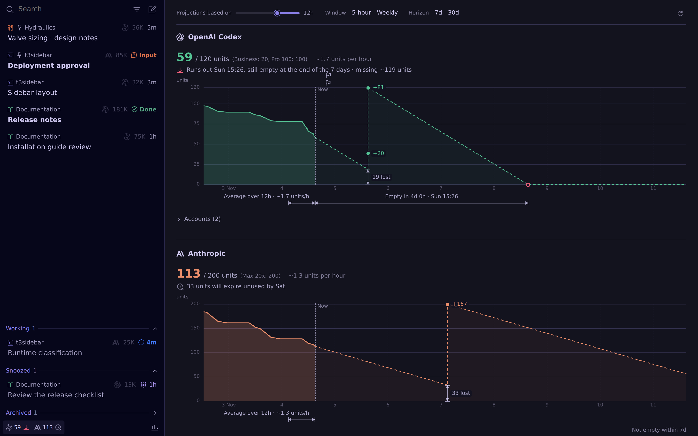

# hermes-t3sidebar

[Hermes Desktop](https://hermes-agent.nousresearch.com/docs/user-guide/desktop) plugin: T3 Code-style session sidebar with status shelves, pins, snooze, unsent-draft markers, project picker, [AutoTitler](https://github.com/Vocllum/hermes-auto-titler) rename, a token/cost **Usage** page and an OpenAI Codex / Anthropic Claude rate-limit **Limits** page.

- Plugin id: `hermes-t3sidebar`
- Parts: **Agent plugin** (backend companion) + **Desktop UI**
- Requires: Hermes `>=0.21.0`
- Optional: `hermes-auto-titler` plugin (Hermes catalog id)

### Session shelves

- **Input**, **Done**, **Woke** badges: question or approval waiting, finished turn, expired snooze.
- Shelves: **Pinned**, **Working** (elapsed time), **Snoozed**, **Archived** (history kept).
- Orange background: unsent draft in a session you are not viewing.
- Cards: project, provider icon, token count including subagents.
- Pins, snoozes and completion markers shared between Desktop clients through the backend companion.

### AutoTitler: rename now

- Right-click a session → **Autotitler: rename now**: AutoTitler retitles it from its current topic, or keeps the title.
- Needs the [hermes-auto-titler](https://github.com/Vocllum/hermes-auto-titler) plugin loaded on the backend; otherwise the action stays visible, disabled, with the reason on hover.

### Detailed Working indicator

- Optional setting.
- Solid circle: the agent's own turn is running.
- Dashed circle: only subagents or a background command keep the session busy.
- `+N`: running subagents.
- Pinched ring: context compaction.

### Usage page

- Footer chart button → **Usage** page.
- Charts on one time axis: tokens, API-equivalent cost, human user messages, as per-day rates.
- Configurable period, per-provider or per-model series, stacking.
- Read-only from Hermes's `session_model_usage`; no extra storage.

### Limits page

- Footer button: remaining units and verdict icon per provider → **Limits** page.
- Providers: OpenAI Codex and Anthropic credential pools; accounts pooled in units weighted by plan.
- Chart: past quota, **Now**, projection; configurable averaging period, limit window and horizon.
- Verdicts: when the pool runs out before a reset, or how many units expire unused.
- Markers: reset step-ups, units lost at each reset, Codex banked reset credit expiries.
- Per-account bars with reset times.
- Backend sampler every 5 minutes, 35 days of history, read-only: never refreshes tokens, clears cooldowns or redeems resets.

### Projects

- **New session** in a chosen project; sessions open in Hermes's normal chat workspace.

- Search sessions or filter by project without changing workspace.

- Right-click: pin, rename, move to project. **Project** submenu: rename, copy path, filter, color, icon.

### Snooze

- Presets or a custom local date and time.
- Never stops or resumes an agent.

### Settings

- Snooze preset time
- Detailed Working indicator
- Pinned session gap
- Show token counts

## Install

1. Open **Capabilities → Plugins → Install from Git** in Hermes Desktop.
2. Enter `https://github.com/V1rgul/hermes-plugin-t3sidebar` and select **Agent plugin** + **Desktop UI**.
3. Enable both halves, open the **t3sidebar** pane, and hide the built-in **Sessions** pane using the normal layout controls.

Remote backend or upgrade: [installation guide](docs/installation.md), including when a backend restart is needed.

## Documentation

- [Installation](docs/installation.md): remote backends, local checkouts, the old Session Flow name.
- [Sidebar behavior](docs/behavior.md): controls, status badges, search, compatibility limits.
- [Usage and Limits](docs/usage.md): data sources, timing approximation, cost, limits sampling.
- [Architecture](docs/architecture.md): backend storage, package layout, performance.
- [Development](docs/development.md): tests, browser harness, screenshots.

The Desktop UI uses the public plugin SDK; some backend reads depend on version-sensitive Hermes internals: [limitations and compatibility](docs/behavior.md#limitations-and-compatibility).
