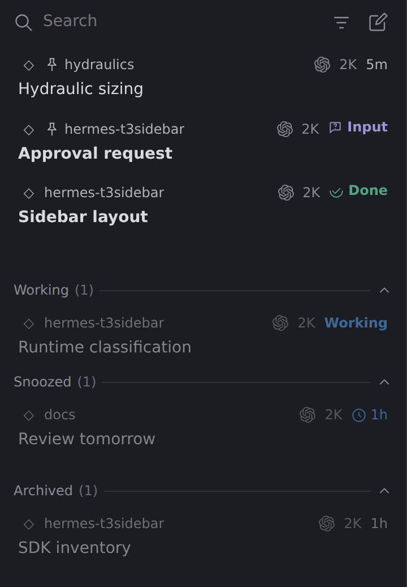

# hermes-t3sidebar

A T3 Code-inspired session sidebar for [Hermes Desktop](https://hermes-agent.nousresearch.com/docs/user-guide/desktop). Keep conversations that need your attention up front, and running jobs out of the way.

| Session overview | Snooze a conversation |
| --- | --- |
|  |  |

*Previews use sample data in the development harness, not a live Desktop connection.*

## What it does

- **See what needs you:** Input, Done and Woke badges highlight questions, completions and expired snoozes.
- **Keep things organized:** pin conversations, separate Working jobs, snooze for later, or archive without deleting history.
- **Find your place:** search sessions, filter by project, and customize project names, colors and icons.
- **Pick up where you left off:** open conversations in Hermes's normal workspace. No replacement chat interface or changes to agent instructions.

Pins, snoozes and completion markers are stored by the backend companion and shared between clients. Snoozing never stops or resumes an agent.

## Install

1. Open **Capabilities → Plugins → Install from Git** in Hermes Desktop.
2. Enter `https://github.com/V1rgul/hermes-plugin-t3sidebar` and select **Agent plugin** + **Desktop UI**.
3. Enable both halves, open the **t3sidebar** pane, and hide the built-in **Sessions** pane using the normal layout controls.

Using a remote backend or upgrading an existing installation? See the [installation guide](docs/installation.md), including when a backend restart is needed.

## Documentation

- [Installation](docs/installation.md) — remote backends, local checkouts and the old Session Flow name.
- [Sidebar behavior](docs/behavior.md) — controls, status badges, search and compatibility limits.
- [Architecture](docs/architecture.md) — backend storage, package layout and performance.
- [Development](docs/development.md) — tests and the browser harness.

The Desktop UI uses the public plugin SDK; some backend reads depend on version-sensitive Hermes internals. See [limitations and compatibility](docs/behavior.md#limitations-and-compatibility) before installing.
