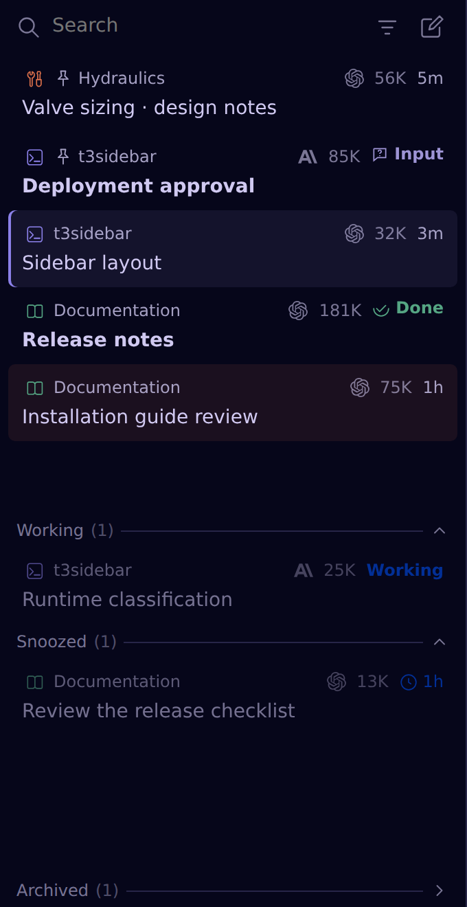
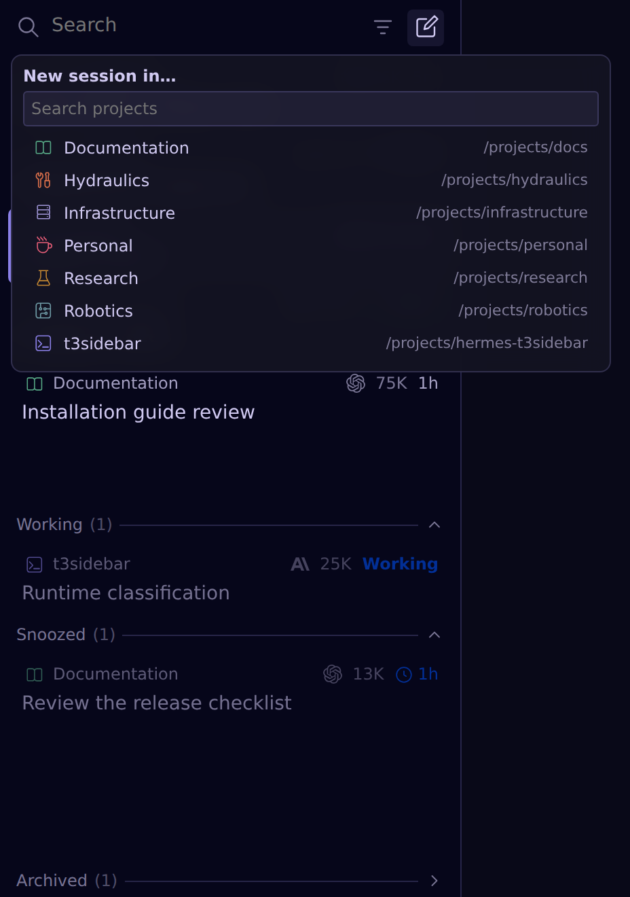
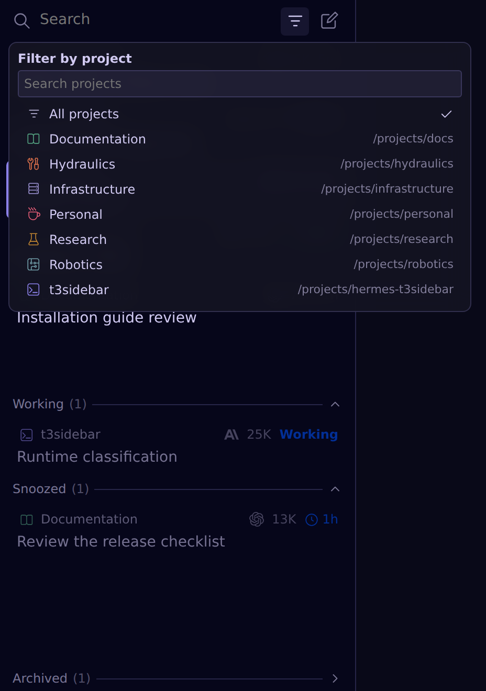
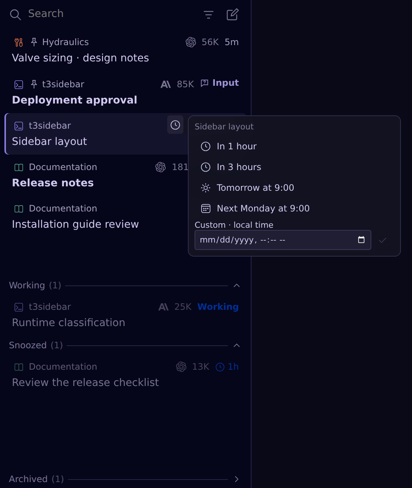
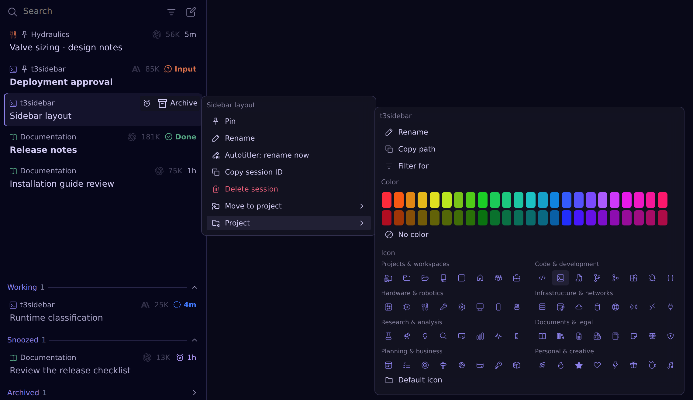

# hermes-t3sidebar

A T3 Code-inspired session sidebar for [Hermes Desktop](https://hermes-agent.nousresearch.com/docs/user-guide/desktop). Keep conversations that need your attention up front, and running jobs out of the way.

### Keep track of your sessions

**Input**, **Done** and **Woke** flag questions, completions and expired snoozes. Pin important conversations, keep running jobs in **Working**, and archive without deleting history. An **orange background** marks unsent text in a session you're not viewing.

### Start in the right project

Choose a project before starting a conversation. Sessions open in Hermes's normal chat workspace.

### Find your place

Search sessions or filter by project without changing your workspace.

### Come back later

Snooze for an hour, three hours, tomorrow, next Monday or a custom local date and time. Snoozing never stops or resumes an agent.

### Organize sessions and projects

Right-click to pin, rename or move a conversation. Open **Project** to rename the project, copy its path, filter for it, or choose its color and icon.

Pins, snoozes and completion markers are shared between clients through the backend companion.

## Install

1. Open **Capabilities → Plugins → Install from Git** in Hermes Desktop.
2. Enter `https://github.com/V1rgul/hermes-plugin-t3sidebar` and select **Agent plugin** + **Desktop UI**.
3. Enable both halves, open the **t3sidebar** pane, and hide the built-in **Sessions** pane using the normal layout controls.

Using a remote backend or upgrading an existing installation? See the [installation guide](docs/installation.md), including when a backend restart is needed.

## Documentation

- [Installation](docs/installation.md) — remote backends, local checkouts and the old Session Flow name.
- [Sidebar behavior](docs/behavior.md) — controls, status badges, search and compatibility limits.
- [Architecture](docs/architecture.md) — backend storage, package layout and performance.
- [Development](docs/development.md) — tests and the browser harness.

The Desktop UI uses the public plugin SDK; some backend reads depend on version-sensitive Hermes internals. See [limitations and compatibility](docs/behavior.md#limitations-and-compatibility) before installing.
