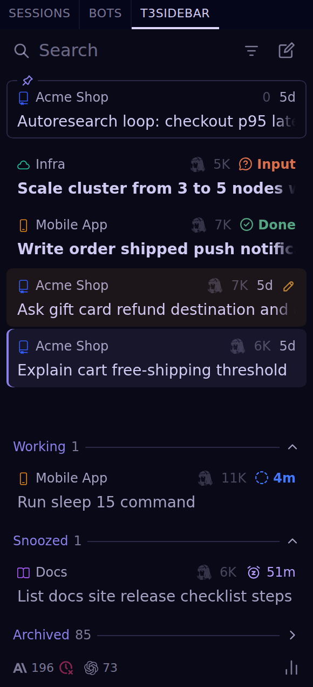
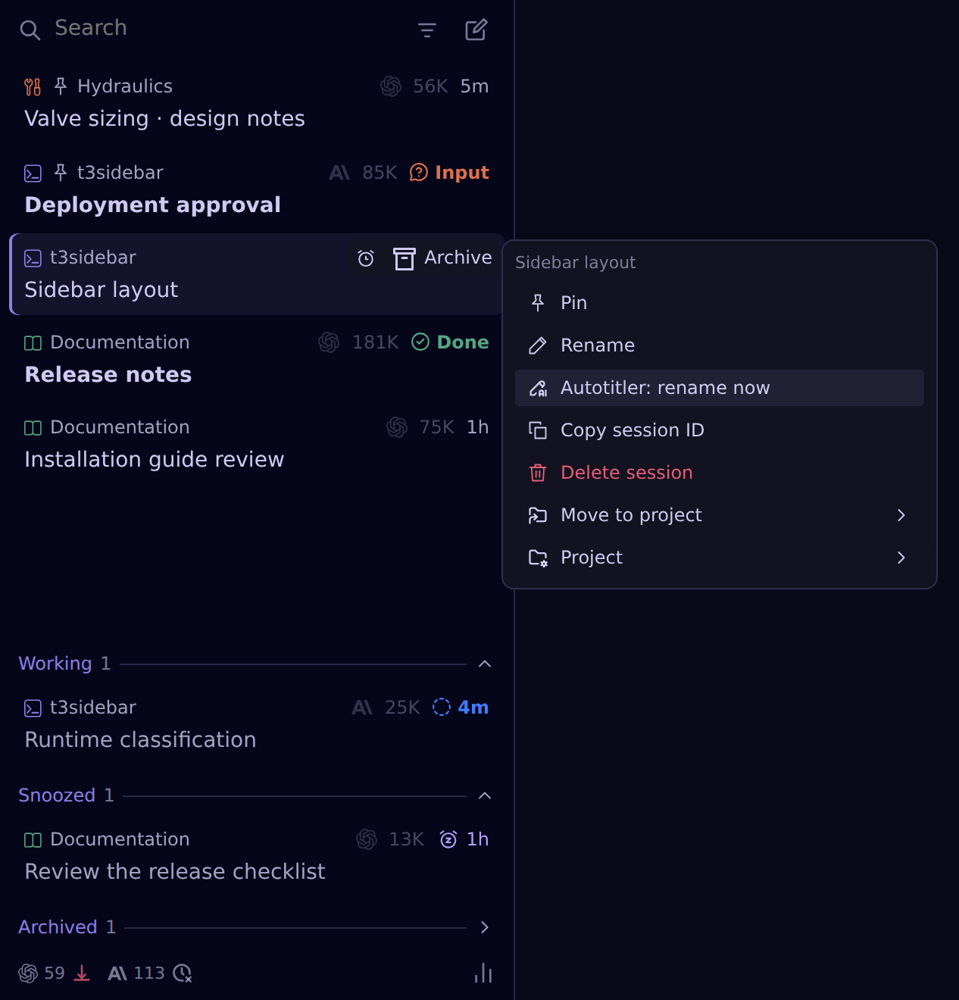
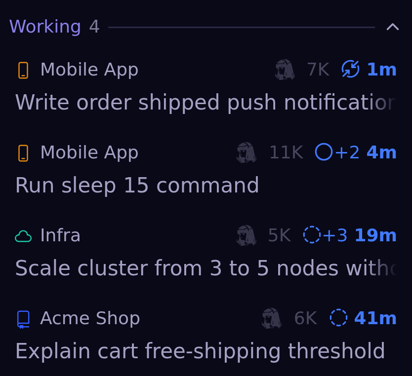
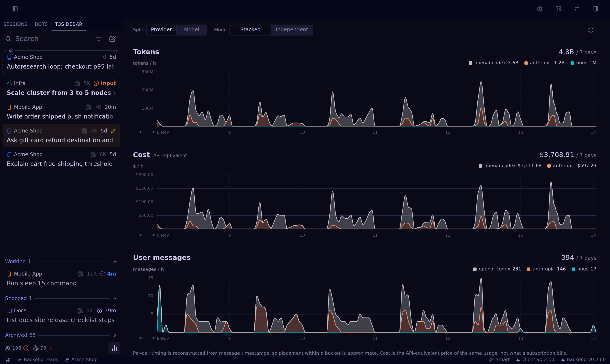
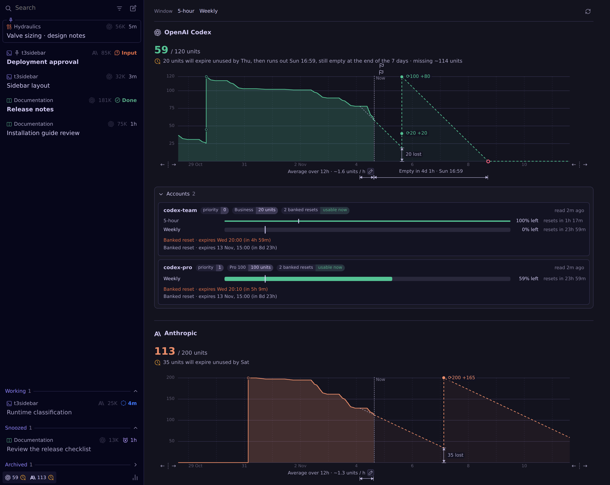
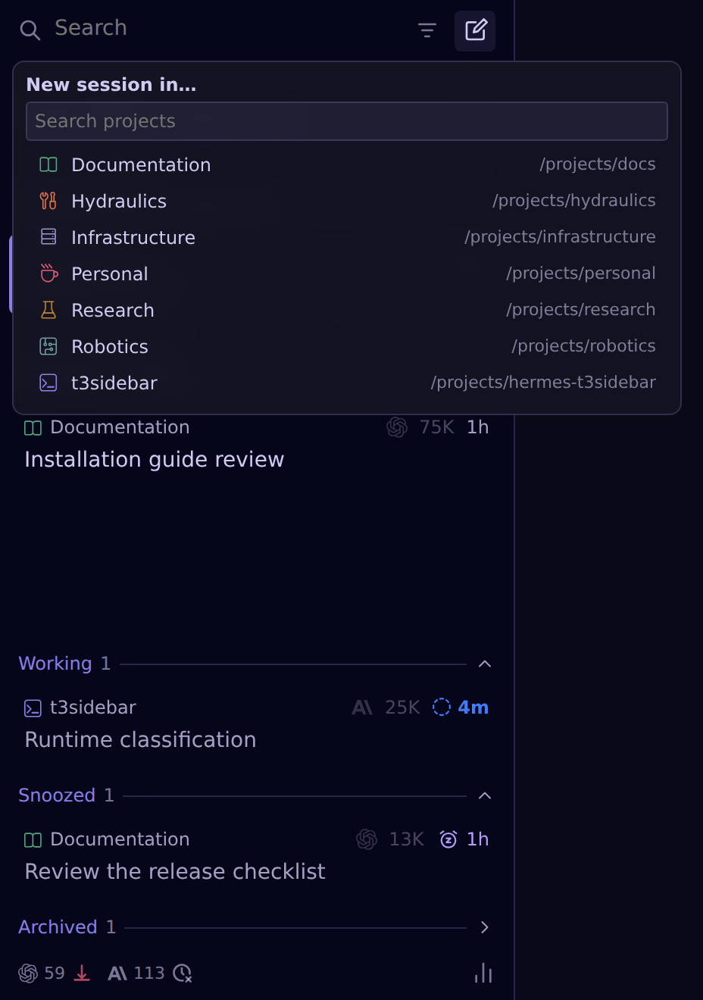
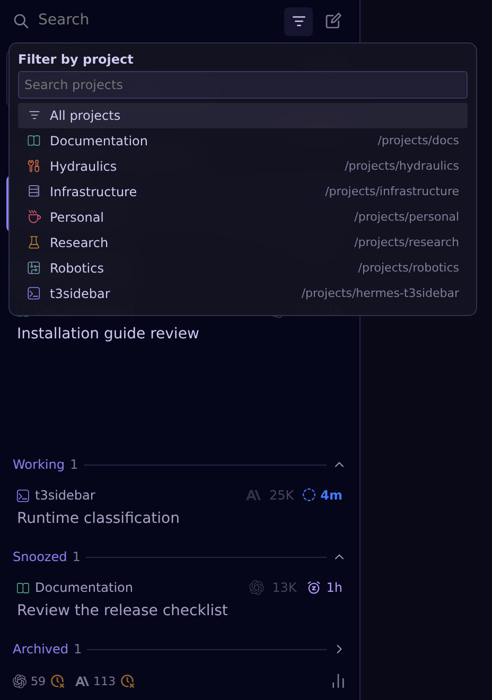
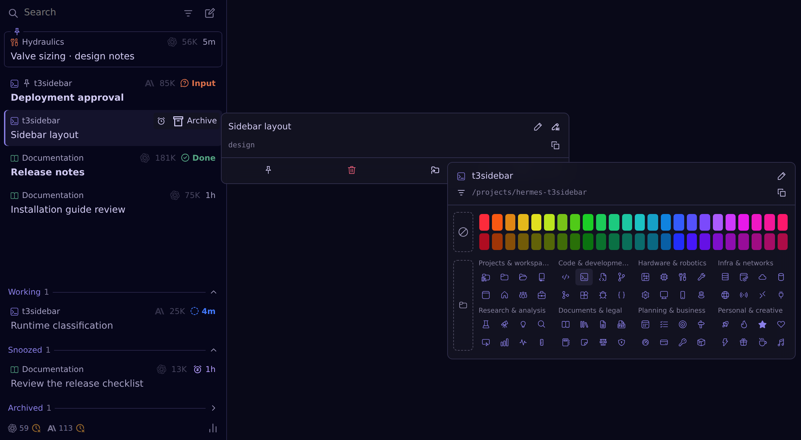
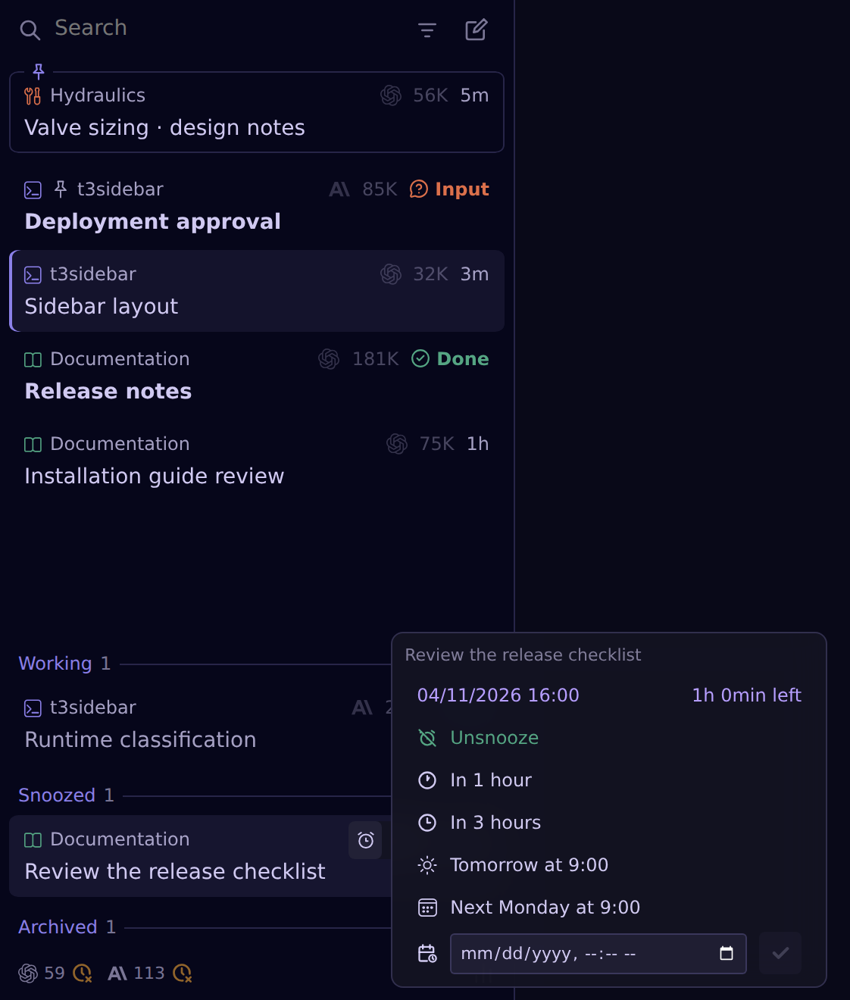
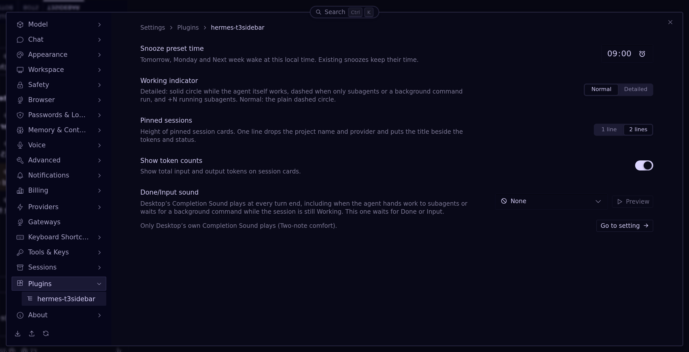

# hermes-t3sidebar

[Hermes Desktop](https://hermes-agent.nousresearch.com/docs/user-guide/desktop) plugin: T3 Code-style session sidebar with status shelves, pins, snooze, unsent-draft markers, project picker, [AutoTitler](https://github.com/Vocllum/hermes-auto-titler) rename, a token/cost **Usage** page and an OpenAI Codex / Anthropic Claude rate-limit **Limits** page.

- Plugin id: `hermes-t3sidebar`
- Parts: **Agent plugin** (backend companion) + **Desktop UI**
- Requires: Hermes `>=0.23.0`
- License: [MIT](LICENSE)
- Optional: `hermes-auto-titler` plugin (Hermes catalog id)

### Session shelves

- **Input**, **Done**, **Woke** badges: question or approval waiting, finished turn, expired snooze.
- Shelves: **Pinned** (one outlined group under a single pin, optionally one line per session), **Working** (elapsed time), **Snoozed**, **Archived** (history kept).
- Orange background: unsent draft in a session you are not viewing.
- Cards: project, provider icon, token count including subagents.
- Pins, snoozes and completion markers shared between Desktop clients through the backend companion.

### AutoTitler: rename now

- Right-click a session → **Autotitler: rename now**: AutoTitler retitles it from its current topic, or keeps the title.
- Needs the [hermes-auto-titler](https://github.com/Vocllum/hermes-auto-titler) plugin loaded on the backend; otherwise the action stays visible, disabled, with the reason on hover.

### Detailed Working indicator

- Optional setting: **Working indicator** → **Detailed**.
- Solid circle: the agent's own turn is running.
- Dashed circle: only subagents or a background command keep the session busy.
- `+N`: running subagents.
- Pinched ring: context compaction.

### Usage page

- Footer chart button → **Usage** page.
- Charts on one time axis: tokens, API-equivalent cost, human user messages, as amounts per bucket sized to the period.
- Configurable period, per-provider or per-model series, stacking.
- Read-only from Hermes's `session_model_usage`; no extra storage.

### Limits page

- Footer button: remaining units and verdict icon per provider → **Limits** page.
- Providers: OpenAI Codex and Anthropic credential pools; accounts pooled in units weighted by plan.
- Chart: past quota, **Now**, projection; configurable averaging period and limit window. Unfold arrows at each end of the x axis set how far back and ahead it reaches (weekly 1d/7d/30d, 5-hour 5h/1d/7d), shared by every chart and remembered on the client.
- Verdicts: when the pool runs out before a reset, or how many units expire unused; the next meaningful event picks the icon. Run-out colour by time blocked in the 7 days (15 min grey, 2 h yellow, 6 h orange, 24 h red), expiry colour by units lost against capacity (5% grey, 15% yellow, 30% orange, 50% red); below that, no icon. A grey warning icon means the verdict cannot be computed (no drain data or stale readings).
- Markers: reset step-ups, units lost at each reset, Codex banked reset credit expiries.
- Per-account bars with reset times.
- Codex banked resets: expiries for the account Hermes is currently using, or for every pool account with an experimental setting; per account, a **Use one** button: green when Codex accepts a reset (an allowance below 80% left), dashed and padlocked otherwise. It confirms with the share of the weekly allowance the reset discards, then redeems through Hermes's own `/usage reset --force` on that account.
- Backend sampler every 5 minutes, 35 days of history, read-only: never refreshes pool tokens, clears cooldowns or redeems resets. An expired Claude Code login is the one exception: Hermes's own Claude Code resolver refreshes it.

### Projects

- **New session** in a chosen project; sessions open in Hermes's normal chat workspace.

- Search sessions or filter by project without changing workspace.

- Right-click: pin, rename, move to project. **Project** submenu: rename, copy path, filter, color, icon.

### Snooze

- Presets or a custom local date and time.
- Never stops or resumes an agent.

### Settings

- Snooze preset time
- Working indicator: Normal or Detailed
- Pinned sessions: 1 or 2 lines
- Show token counts
- Experimental: banked reset expiries for every Codex account (off by default). Each experimental feature turns itself off, with its switch disabled and an *Incompatible with your Hermes version* note, when the Hermes internals it relies on are gone.

## Install

1. Open **Capabilities → Plugins → Install from Git** in Hermes Desktop.
2. Enter `https://github.com/V1rgul/hermes-plugin-t3sidebar` and select **Agent plugin** + **Desktop UI**.
3. Enable both halves, open the **t3sidebar** pane, and hide the built-in **Sessions** pane using the normal layout controls.

Remote backend or upgrade: [installation guide](docs/installation.md), including when a backend restart is needed.

## Disclosure

- **Network:** for the Limits page only, through Hermes's own fetchers. Every 5 minutes per account: the Codex usage endpoint on `chatgpt.com` and `api.anthropic.com/api/oauth/usage`. At most once an hour: the banked reset credit list of the Codex account Hermes currently uses, sent by Hermes with its own sign-in (`requires_auth: [openai-codex]`), or, with the experimental per-account setting, of every Codex pool account with its own token. In the Claude Code fallback only (no Anthropic account in Hermes): `api.anthropic.com/api/oauth/profile`, for the plan tier. A Codex banked reset is redeemed only after a confirmed click, through Hermes's `/usage reset --force`.
- **Background:** one sampler thread starts on the first Desktop poll after a backend start and keeps sampling every 5 minutes, also while Desktop is closed. The `pre_llm_call` and `on_session_end` hooks run on every turn and session end, to record completions for the Done badge.
- **Reads outside its own data:** Hermes `state.db` and `projects.db` (read-only), Hermes's credential pool via `read_credential_pool`, and Claude Code's `.credentials.json` (fallback only).
- **Writes:** session rename, archive and delete through Hermes's own session code, and the plugin's own `<HERMES_HOME>/plugin-data/hermes-t3sidebar/state.sqlite3` and `usage-limits.sqlite3` (35 days of samples). When Claude Code's token has expired, Hermes's own resolver refreshes it under Hermes's cross-process lock and writes it back to Claude Code's credentials file; the plugin never refreshes or writes a token itself.
- **Not done:** no stored or logged credentials, no telemetry, no shell commands, no self-updating code.

## Documentation

- [Installation](docs/installation.md): remote backends, local checkouts, the old Session Flow name.
- [Sidebar behavior](docs/behavior.md): controls, status badges, search, compatibility limits.
- [Usage and Limits](docs/usage.md): data sources, timing approximation, cost, limits sampling.
- [Architecture](docs/architecture.md): backend storage, package layout, performance.
- [Development](docs/development.md): tests, browser harness, test Webapp container, screenshots.

The Desktop UI uses the public plugin SDK; some backend reads depend on version-sensitive Hermes internals: [limitations and compatibility](docs/behavior.md#limitations-and-compatibility).
